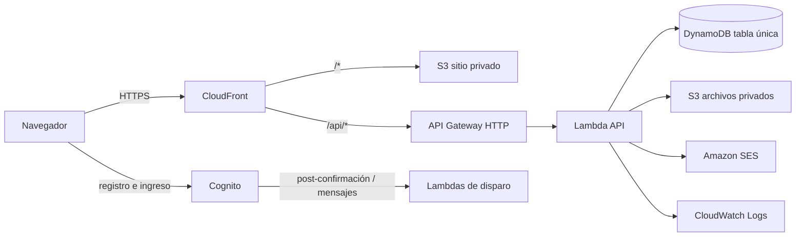

# Arquitectura

## Vista general



Todo es _serverless_ y de pago por uso, como se acordó en el Acta 002: sin servidores encendidos.

## Backend: arquitectura hexagonal

```
api/src
├── domain/        Reglas del negocio puras. Sin AWS ni HTTP.
├── application/   Casos de uso y puertos (interfaces).
├── adapters/      http (Hono), dynamodb, aws (S3, SES, JWT), local.
├── bootstrap/     Composición: lambda.ts (AWS) y local.ts (desarrollo).
└── triggers/      Lambdas de Cognito.
```

Las dependencias apuntan hacia adentro; ESLint lo hace cumplir (`no-restricted-imports`).
La misma aplicación Hono corre en Lambda y en local; solo cambia la composición en `bootstrap/`.

Por qué: la directora tendrá pasarela de pago y API de Siigo como evolución (HU-27, HU-28).
Con puertos, esos cambios son un adaptador nuevo y no una reescritura.

## Decisiones

| ADR | Decisión |
| --- | --- |
| [0001](adr/0001-monorepo-y-stack.md) | Monorepo TypeScript: React, Hono, AWS CDK |
| [0002](adr/0002-tabla-unica-sin-transacciones.md) | Tabla única; acceso derivado de la compra |
| [0003](adr/0003-busqueda-en-memoria.md) | Búsqueda en memoria en la Lambda |
| [0004](adr/0004-autenticacion-cognito.md) | Cognito y verificación de grupos en el servidor |
| [0005](adr/0005-ambientes-dev-y-prod.md) | Ambientes dev y prod en la misma cuenta |

## Seguridad y datos personales (Ley 1581 de 2012)

- La respuesta completa se guarda en un ítem separado: las consultas de catálogo no pueden
  devolverla por error.
- Las contraseñas solo las maneja Cognito. Los logs nunca incluyen datos del cliente.
- Comprobantes y adjuntos van a un bucket privado, con URL prefirmadas de 5 minutos.
- El HTML de las fichas se sanea al guardar en el servidor y otra vez al mostrar en el navegador.
- DynamoDB y S3 cifran en reposo; todo el tráfico va por HTTPS.
